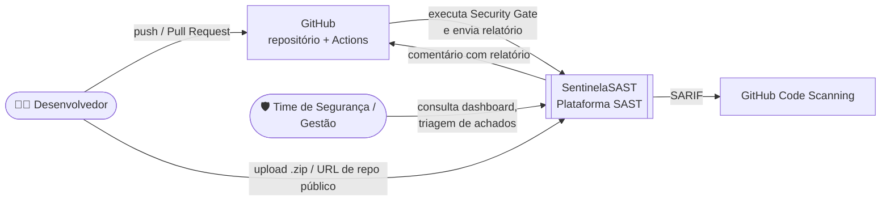
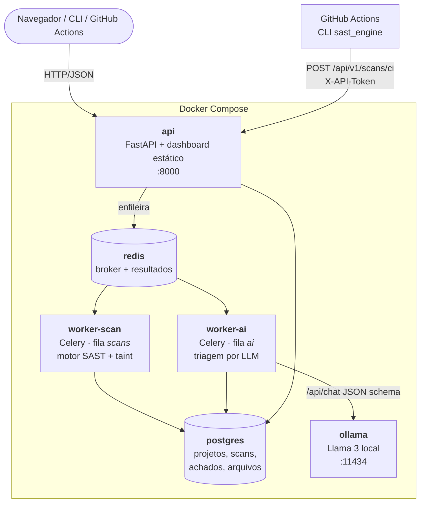
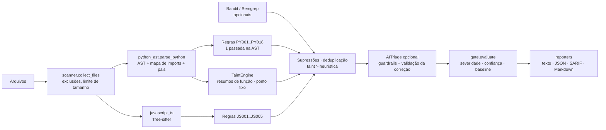
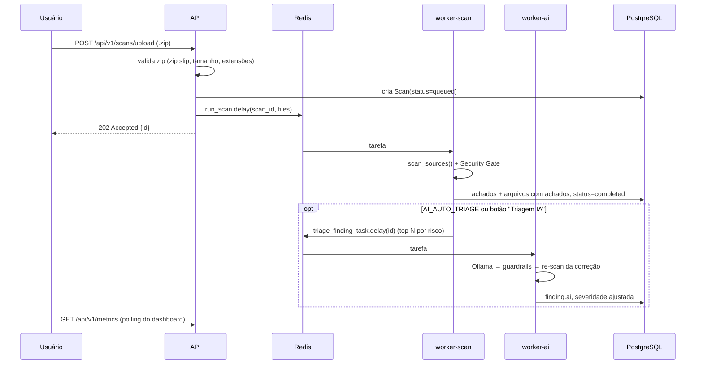

# Arquitetura técnica

Diagramas no modelo **C4**, em Mermaid (o GitHub renderiza direto).

## Nível 1 — Contexto

## Nível 2 — Containers

| Container | Responsabilidade | Escala |
|---|---|---|
| `api` | REST, validação de entrada, ingestão segura (zip/git), métricas, dashboard | horizontal (stateless) |
| `worker-scan` | parsing, regras, taint, gate; CPU-bound e rápido | `-c 4` por réplica |
| `worker-ai` | chamadas ao LLM; lento e limitado pela GPU | `-c 1` (fila própria evita travar varreduras) |
| `postgres` | persistência relacional (histórico para tendência) | — |
| `redis` | broker Celery | — |
| `ollama` | LLM local; o código não sai da rede | GPU opcional |

## Nível 3 — Componentes do motor (`sast_engine`)

## Fluxo de uma varredura assíncrona

## Decisões de arquitetura (ADRs resumidos)

1. **Python como linguagem alvo.** O `ast` da biblioteca padrão dá uma AST fiel e estável, sem dependências. Python também é a linguagem do Bandit, que usamos como referência de comparação.
2. **Motor sem dependências externas.** A CLI roda em qualquer runner de CI com `python -m sast_engine`, sem `pip install`. Isso reduz o tempo de pipeline e a superfície de supply chain.
3. **Uma única passada na AST.** Cada regra declara os tipos de nó que inspeciona (`@python_rule("PY002", ast.Call)`) e o scanner despacha cada nó só para as regras interessadas. O custo fica em O(nós), e não O(nós × regras).
4. **Taint por resumos de função com ponto fixo**, em vez de inlining. Cada função é analisada uma vez por iteração e as chamadas usam o resumo (parâmetro→retorno, parâmetro→sink). Isso escala para projetos inteiros e suporta recursão.
5. **Duas filas Celery.** O LLM leva segundos por achado. Se dividisse a fila com as varreduras, um PR grande travaria a análise de todos os outros.
6. **IA como assistente, não como juiz.** O LLM não remove sozinho um fluxo de taint comprovado e só ajusta a severidade em ±1 nível, e as correções são re-escaneadas (ver `docs/ia.md`). O resultado continua determinístico e auditável.
7. **Fingerprint independente de linha** (`regra + arquivo + trecho normalizado`). Permite comparar varreduras (novos × corrigidos, baseline do gate) mesmo quando o código é deslocado.
8. **SARIF 2.1.0** como formato de integração: o GitHub Code Scanning mostra os achados inline no PR, com `codeFlows` para o caminho do taint.

## Segurança da própria plataforma

| Ameaça | Controle |
|---|---|
| Zip slip / zip bomb no upload | caminhos absolutos ou com `..` são rejeitados; limite de tamanho descompactado e de nº de arquivos; symlinks ignorados; extração em memória |
| SSRF / injeção via URL de repositório | regex estrita `https://host/dono/repo`, allowlist de hosts, `git clone -- URL` sem shell, `GIT_TERMINAL_PROMPT=0`, timeout |
| Ingestão do CI forjada | `X-API-Token` comparado com `hmac.compare_digest` |
| XSS no dashboard | todo dado da API passa por `esc()` antes de `innerHTML` (exceção documentada em `.sast.toml`) |
| Vazamento de código para terceiros | LLM local (Ollama) |
| Container | usuário sem privilégios (`uid 10001`), imagem slim, Trivy no CI |
| Dogfooding | o pipeline roda o SentinelaSAST, o Bandit e o Semgrep no próprio código da plataforma |
